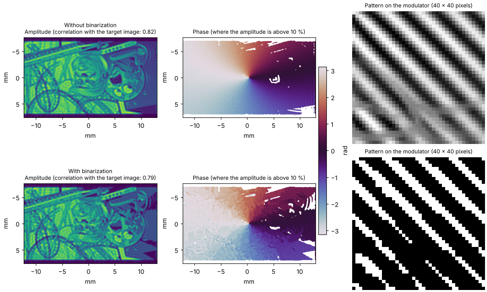

Algorithm reference
===================

This page details every algorithm of the list of the extension (see :ref:`sec-algorithms-overview` for the overview
table): what it does, for which setup and the settings that appear in the *Algorithm* settings when it is selected.
Sizes of pixels in these settings follow the shaper (see :doc:`shapers`).

Settings shared by the algorithms
---------------------------------

Most algorithms start from an *initial phase* of the modulator, which is also a choice in the settings:

* **Random**: a random phase.
* **Quadratic**: a quadratic phase ``R (p² + q²) + D (p cos θ + q sin θ)`` (``p`` and ``q`` are the normalized pixel
  indexes, see :cite:t:`bowman_high-fidelity_2017`) with the groups *Quadratic
  Amplitude* (``Auto`` computes the X and Y amplitudes from the size of the target mask, ``X Quad.``, ``Y Quad.``,
  ``Coeff`` as a multiplicative coefficient) and *Linear Shift* (``Auto`` computes the shift from the position of the
  target mask, ``X Shift``, ``Y shift``).

*Direct* does not use an initial phase.

Direct
------

Sends the selected target field directly to the modulator: its phase, its amplitude or both depending on the type of
modulation of the shaper. No propagation model is involved (no lens) and the algorithm is not iterative.

*Settings*: none.

Diffractive
-----------

Creates an amplitude image with a **phase-only** modulator in a **4f** line with a circular filter in the Fourier plane
that removes the undiffracted light. Not iterative. Implements the five methods A to E discussed in
:cite:t:`Clark2016`.

*Settings*:

* ``Gamma`` (default 4): period of the modulation grating, in pixels.
* ``Diffractive Models``: *Relative Amplitude* (method A), *Scattering* (B), *Davis* (C), *Bolduc* (D) or *Arrizon* (E).
* ``Order N`` (default 10).

OL2014 - Amplitude/Phase Checkerboard
-------------------------------------

Creates **amplitude and phase** images with a phase-only modulator in a **4f** line with a filter in the Fourier plane,
by encoding the complex field on a checkerboard (:cite:t:`mendoza-yero_encoding_2014`). Not iterative.

*Settings*:

* ``Mask block size (pxls)`` (default 5): size of the blocks of the checkerboard.
* ``amplitude divider`` (default 1).

DMD Lee
-------

Creates **amplitude and phase** images with a binary **amplitude** modulator such as a DMD (Lee hologram, W.H. Lee,
Progress in Optics, 1978), in a **4f** line with a filter in the Fourier plane that selects one diffraction order. Not
iterative. The pattern sent to the modulator is ``½ (1 + A cos(2π (x - y) / period - φ))``: a grating whose phase
shift is the phase ``φ`` of the target and whose modulation depth ``A`` is its amplitude, normalised so that its
maximum is 1. The first order of the grating, selected by the mask of the intermediate plane (*Intermediate Masking*
settings, which this algorithm needs), is the target field.

*Settings*:

* ``Super Pixel size (pxls)`` (default 5): period of the grating, in pixels. The binary pattern can only render as many
  amplitude levels as the period has pixels, so a wider period gives a more faithful amplitude (8 pixels or more is
  advisable, the figure below uses 10), at the cost of a smaller field (the orders are further apart in the spectrum).
* ``Binarize`` (default checked): the pattern is binarized, as a DMD can only switch its pixels on or off. Unchecked,
  the grey levels of the pattern are kept (an ideal modulation, not feasible on a DMD, to see what the binarization
  costs).
* ``Binarization`` (default *Width modulation*): *Width modulation* is the binary Lee hologram: the pixel is on where
  ``cos(θ) > sqrt(1 - A²)``, so the stripes are wider where the amplitude is higher, and the first order has the
  amplitude ``A`` (up to the factor 2/π lost to the binarization). *Threshold* compares the grey pattern to
  ``threshold``: with the default 0.5 this is equivalent to ``cos(θ) > 0`` whatever ``A``, the amplitude of the target
  is lost and only its phase is kept.
* ``threshold`` (default 0.5): level of the *Threshold* binarization.
* ``Remove carrier`` (default checked), ``Carrier from`` and ``Carrier factor``: see below.

**The carrier.** The selected order is off the optical axis, so the output field carries a linear phase (a tilt of the
beam, the *carrier*) on top of the phase of the target. With *Remove carrier* the algorithm removes it numerically: the
spectrum is shifted so that the position of the order goes to the zero frequency. This position is the center of the
mask (``Carrier from``: *Mask center*) or the center of gravity of the intensity of the spectrum inside the mask
(*Spectrum centroid*, closer to the real peak, the default), multiplied by ``Carrier factor`` (1: all of it).

This is a computation convenience, not what the setup does. In the setup, the carrier should normally be cancelled
optically, by moving the second lens of the 4f slightly off the optical axis, together with the filter, so that the
selected order goes through the axis of the lens: the beam then leaves the lens parallel to the optical axis, without
tilt. The phase of the output plane of the algorithm is then the one of the setup. This follows from the paraxial
model of the 4f line used by the extension, it is not checked on a real setup.

**Result with and without binarization.** The figure below shows the output field computed by the algorithm for a
target whose amplitude is an image and whose phase is a vortex of charge 1, with the binarization off (top) and on
(bottom, width modulation), and the part of the pattern sent to the modulator in each case. The binarization costs some
fidelity on the amplitude (correlation with the target image: 0.82 and 0.79, computed inside the target region) and
adds some noise, but the phase of the vortex is kept. The figure is made by ``docs/scripts/dmd_lee_snapshots.py``.

Gerchberg-Saxton
----------------

The classic iterative phase retrieval (:cite:t:`gerchberg_practical_1972`) for an amplitude image with a phase-only modulator
in the Fourier plane of a lens (**2f**). The wavelength and the focal length of the lens are those of the experimental
setup.

*Settings*: none.

Projections
-----------

Gerchberg-Saxton with variants, **2f** setup, iterative.

* **Weighting**: weights the target amplitude with the difference to the calculated output amplitude
  (:cite:t:`Wu2021`).
* **MRAF** (Mixed-Region Amplitude Freedom, :cite:t:`pasienski_high-accuracy_2008`): the amplitude is imposed in a signal region and left free in the rest. A
  region of interest (rectangular or elliptical) has to be selected in the target plane.

*Settings*:

* ``Weighting`` (default off).
* ``Mixing ratio`` (default 0.5, between 0 and 1): the MRAF parameter. 1 is the standard Gerchberg-Saxton algorithm.

slmsuite Hologram
-----------------

Gerchberg-Saxton and weighted Gerchberg-Saxton methods computed by slmsuite, **2f** setup, iterative. Provided by
``pymodaq_plugins_slmsuite`` (:doc:`slmsuite`).

*Settings*: ``Method`` (GS, WGS-Leonardo, WGS-Kim, WGS-Nogrette, WGS-Wu, WGS-tanh), ``Iterations per step``, and the
settings of the chosen method (feedback exponent, feedback factor, iteration at which the phase is fixed) with the
defaults of slmsuite, see :doc:`slmsuite`.

Minimize and TorchOptim
-----------------------

* **Minimize** uses the minimizers of ``pytorch-minimize``.
* **TorchOptim** uses the L-BFGS optimizer of ``pytorch``.

*Settings* (both):

* ``Max Iterations`` (default 100) and ``Tolerance`` (default 1e-9).
* ``Loss``: the loss function and, in *Loss Parameters*, its own settings (the value of the loss is displayed in
  ``Loss Value``).

  .. list-table::
     :header-rows: 1
     :widths: 28 17 55

     * - **Loss**
       - **Shapes**
       - **Settings (default)**
     * - LeastSquares
       - amplitude
       - none
     * - MSELoss
       - amplitude
       - none
     * - SmoothL1Loss
       - amplitude
       - ``Beta`` (0.5)
     * - LeastExponent
       - amplitude
       - ``Loss exponent`` (4)
     * - Chicken
       - amplitude and phase
       - ``Power exponent`` (9), ``Sum exponent`` (2)
     * - ChickenArnaud
       - amplitude and phase
       - ``Ratio`` (1)
     * - LSQAmplitudePhase
       - amplitude and phase
       - ``Amplitude exponent`` (1), ``Phase exponent`` (1)

  .. warning::
     The amplitude-only losses work well. The three losses that shape both amplitude and phase (*Chicken*,
     *ChickenArnaud*, *LSQAmplitudePhase*, after :cite:t:`bowman_high-fidelity_2017`) give results that are **not satisfactory yet** and
     do not seem to reproduce the ones of the paper.

*Minimize* only: ``Method`` of the minimizer (default l-bfgs): bfgs, l-bfgs, cg, newton-cg, newton-exact, dogleg,
trust-ncg, trust-exact or trust-krylov.
