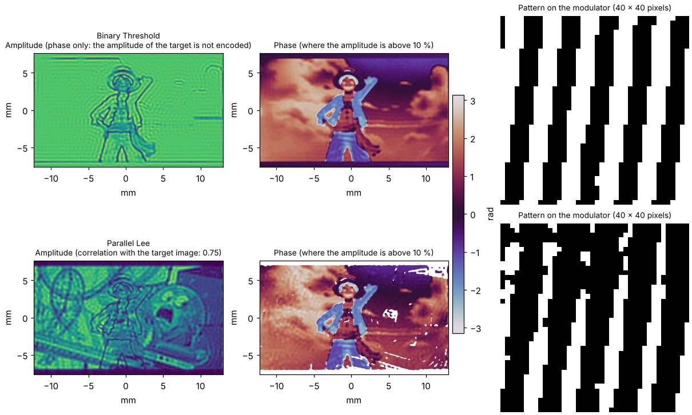

Algorithm reference
===================

This page details every algorithm of the list of the extension (see :ref:`sec-algorithms-overview` for the overview
table): what it does, for which setup and the settings that appear in the *Algorithm* settings when it is selected.
Sizes of pixels in these settings follow the shaper (see :doc:`shapers`).

Settings shared by the algorithms
---------------------------------

The settings of the algorithm app (initial phase, masks, crosstalk, compensation of the input beam...) and the own
settings of each algorithm are saved in the configuration file, **per algorithm**, and loaded back when the algorithm
is selected (an algorithm never run keeps the values of the previous one).

Most algorithms start from an *initial phase* of the modulator, which is also a choice in the settings:

* **Random**: a random phase.
* **Quadratic**: a quadratic phase ``R (p² + q²) + D (p cos θ + q sin θ)`` (``p`` and ``q`` are the normalized pixel
  indexes, see :cite:t:`bowman_high-fidelity_2017`) with the groups *Quadratic
  Amplitude* (``Auto`` computes the X and Y amplitudes from the size of the target mask, ``X Quad.``, ``Y Quad.``,
  ``Coeff`` as a multiplicative coefficient) and *Linear Shift* (``Auto`` computes the shift from the position of the
  target mask, ``X Shift``, ``Y shift``).

*Direct* does not use an initial phase.

Direct
------

Sends the selected target field directly to the modulator: its phase, its amplitude or both depending on the type of
modulation of the shaper. No propagation model is involved (no lens) and the algorithm is not iterative.

*Settings*: none.

Diffractive
-----------

Creates an amplitude image with a **phase-only** modulator in a **4f** line with a circular filter in the Fourier plane
that removes the undiffracted light. Not iterative. Implements the five methods A to E discussed in
:cite:t:`Clark2016`.

*Settings*:

* ``Gamma`` (default 4): period of the modulation grating, in pixels.
* ``Diffractive Models``: *Relative Amplitude* (method A), *Scattering* (B), *Davis* (C), *Bolduc* (D) or *Arrizon* (E).
* ``Order N`` (default 10).

OL2014 - Amplitude-Phase Checkerboard
-------------------------------------

Creates **amplitude and phase** images with a phase-only modulator in a **4f** line with a filter in the Fourier plane,
by encoding the complex field on a checkerboard (:cite:t:`mendoza-yero_encoding_2014`). Not iterative.

*Settings*:

* ``Mask block size (pxls)`` (default 5): size of the blocks of the checkerboard.
* The input beam is compensated (see *Compensations of the input beam* below): the amplitude of the target is divided by the one of
  the beam before the angles of the checkerboard are computed.
* ``amplitude divider`` (default 1).

.. _sec-algo-amplitude-modulation:

Amplitude modulation: binary holograms
--------------------------------------

A family of algorithms for **binary amplitude modulators** such as the DMDs, in a **4f** line with a filter in the
Fourier plane that selects one diffraction order (the theory is in :ref:`sec-theory-amplitude-modulation`, after the
review :cite:t:`gutierrez-cuevas_binary_2024`). They are not iterative. The pattern sent to the modulator is a grating
of carrier ``ν = (1/px, -1/py)`` whose fringes are shifted by the phase ``φ`` of the target; the order selected by the
mask of the intermediate plane (*Intermediate Masking* settings, which these algorithms need) is the target field.

.. list-table::
   :header-rows: 1
   :widths: 20 20 60

   * - Algorithm
     - Modulation
     - Principle
   * - Binary Threshold
     - phase only
     - the grey grating is cut at its mean (:cite:t:`bryngdahl_interferograms_1968`)
   * - Parallel Lee
     - amplitude and phase
     - the width of the fringes follows the amplitude (:cite:t:`lee_binary_1974`)
   * - Superpixel
     - amplitude and phase
     - blocks of n x n pixels whose on / off pattern gives a complex value (:cite:t:`goorden_superpixel-based_2014`)

The orthogonal Lee hologram, that codes the amplitude along a direction orthogonal to the one of the phase, is described
in the review but not available.

*Settings common to the algorithms*:

* ``Period px (pxls)`` (default 4) and ``Period py (pxls)`` (default 16): periods of the grating along x and y, in
  pixels. ``py`` is 0 (aligned grating, ``ν = (1/px, 0)``) or a multiple of ``px`` (the tilted lattice of the review,
  its default ``py = px²`` being the compromise it proposes); another value is corrected to a multiple. For
  *Superpixel*, ``py`` is imposed to ``px²`` (read only).
* ``Binarize`` (default checked): the pattern is binarized, as a DMD can only switch its pixels on or off. Unchecked,
  the grey levels of the pattern are kept (the grey off-axis hologram, an ideal modulation not feasible on a DMD, to
  see what the binarization costs).
* The compensation of the input beam is not a setting of the algorithm: see *Compensations of the input beam* below.
* ``Remove carrier`` (default checked), ``Carrier from`` and ``Carrier factor``: see below.
* ``Order position``: a read-only text, updated with the periods, giving the position of the order to filter, and the
  slices of a mask around it that can be copied to the slices of the *Intermediate Masking*.

What is sent to the modulator is the *SLM field* (``slm_field`` of the algorithm, ``slm`` data): the amplitude pattern
(0 and 1 for a DMD, 1 for a phase-only modulator) and the phase (0 for an amplitude-only modulator), without the
corrections that the extension adds when sending. It is not the *modulator field*, the field just after the modulator:
this one is the input beam times the SLM field (input phase included), and is the one used to compute the output. See
:ref:`sec-algorithm-fields`.

The two first orders of the grating carry opposite phases, and this is physical: the order at ``+ν`` carries the phase
``-φ`` of the target, the one at ``-ν`` (the order (-1, 0) of the review) carries ``+φ``. Select the order that carries
the phase of the target: the one the *Order position* gives.

Binary Threshold
~~~~~~~~~~~~~~~~

Encodes the **phase** of the target. The pattern is on where ``cos(2π ν·r - φ) > 0`` (Eq. 9 of the review), whatever
the amplitude of the target, which is lost.

* ``threshold`` (default 0.5, the mean of the grey pattern): level above which the grey pattern ``½ (1 + cos(2π ν·r - φ))``
  is on.

Parallel Lee
~~~~~~~~~~~~

Encodes **amplitude and phase**: a pixel is on where ``cos(2π ν·r - φ) > cos(π q)`` with ``A = sin(π q)`` (Eq. 11 of the
review), ``A`` being the amplitude of the target, normalised so that its maximum is 1. Unchecking *Binarize* gives the
grey pattern ``½ (1 + A cos(2π ν·r - φ))``. The amplitude levels that the binary pattern can render are limited by the
period of the grating: a wider period gives a more faithful amplitude.

Superpixel
~~~~~~~~~~~

Encodes **amplitude and phase** on superpixels of ``px × px`` pixels (``px`` from 2 to 4), in the lattice
``ν = (1/px, -1/px²)``: the ``px²`` mirrors of a superpixel have phasors uniformly spread on the unit circle, so that
the choice of the mirrors that are on gives a complex value to the superpixel (6561 distinct values for ``px`` = 4, 343
for 3). Each superpixel takes the combination whose value is the closest to the mean of the target over it, found in a
table of all the combinations, computed once for each ``px`` (:cite:t:`goorden_superpixel-based_2014`). The filter of the
Fourier plane averages the mirrors of a superpixel: the resolution of the target is the one of a superpixel.

The target amplitude, normalised so that its maximum is 1, is scaled to the radius of the disk of the complex plane in
which any value is available (0.27 for ``px`` = 4, 0.18 for 3), the efficiency of the method being the square of it.
``px`` = 2 has only 9 values: the phase is coarse. ``py`` = ``px²`` is imposed.

**The carrier.** The selected order is off the optical axis, so the output field carries a linear phase (a tilt of the
beam, the *carrier*) on top of the phase of the target. With *Remove carrier* the algorithm removes it numerically: the
spectrum is shifted so that the position of the order goes to the zero frequency. This position is the center of the
mask (``Carrier from``: *Mask center*) or the center of gravity of the intensity of the spectrum inside the mask
(*Spectrum centroid*, closer to the real peak, the default), multiplied by ``Carrier factor`` (1: all of it).

This is a computation convenience, not what the setup does. In the setup, the carrier should normally be cancelled
optically, by moving the second lens of the 4f slightly off the optical axis, together with the filter, so that the
selected order goes through the axis of the lens: the beam then leaves the lens parallel to the optical axis, without
tilt. The phase of the output plane of the algorithm is then the one of the setup. This follows from the paraxial
model of the 4f line used by the extension, it is not checked on a real setup.

**Result.** The figure below shows the output field computed by the three algorithms for a target given by the default
*ImageFiles* loader (an image and its associated phase), and the part of the pattern sent to the modulator. Binary
Threshold keeps the phase of the target but not its amplitude; Parallel Lee and Superpixel keep both, with some noise
from the binarization (the periods of the figure are 8 pixels along x for the Lee holograms, 4 for the superpixels). The figure is made by ``docs/scripts/binary_holograms_snapshots.py``.

Gerchberg-Saxton
----------------

The classic iterative phase retrieval (:cite:t:`gerchberg_practical_1972`) for an amplitude image with a phase-only modulator
in the Fourier plane of a lens (**2f**). The wavelength and the focal length of the lens are those of the experimental
setup.

*Settings*: none.

Projections
-----------

Gerchberg-Saxton with variants, **2f** setup, iterative.

* **Weighting**: weights the target amplitude with the difference to the calculated output amplitude
  (:cite:t:`Wu2021`).
* **MRAF** (Mixed-Region Amplitude Freedom, :cite:t:`pasienski_high-accuracy_2008`): the amplitude is imposed in a signal region and left free in the rest. A
  region of interest (rectangular or elliptical) has to be selected in the target plane.

*Settings*:

* ``Weighting`` (default off).
* ``Mixing ratio`` (default 0.5, between 0 and 1): the MRAF parameter. 1 is the standard Gerchberg-Saxton algorithm.

slmsuite Hologram
-----------------

Gerchberg-Saxton and weighted Gerchberg-Saxton methods computed by slmsuite, **2f** setup, iterative. Provided by
``pymodaq_plugins_slmsuite`` (:doc:`slmsuite`).

*Settings*: ``Method`` (GS, WGS-Leonardo, WGS-Kim, WGS-Nogrette, WGS-Wu, WGS-tanh), ``Iterations per step``, and the
settings of the chosen method (feedback exponent, feedback factor, iteration at which the phase is fixed) with the
defaults of slmsuite, see :doc:`slmsuite`.

Minimize and TorchOptim
-----------------------

* **Minimize** uses the minimizers of ``pytorch-minimize``.
* **TorchOptim** uses the L-BFGS optimizer of ``pytorch``.

*Settings* (both):

* ``Max Iterations`` (default 100) and ``Tolerance`` (default 1e-9).
* ``Loss``: the loss function and, in *Loss Parameters*, its own settings (the value of the loss is displayed in
  ``Loss Value``).

  .. list-table::
     :header-rows: 1
     :widths: 28 17 55

     * - **Loss**
       - **Shapes**
       - **Settings (default)**
     * - LeastSquares
       - amplitude
       - none
     * - MSELoss
       - amplitude
       - none
     * - SmoothL1Loss
       - amplitude
       - ``Beta`` (0.5)
     * - LeastExponent
       - amplitude
       - ``Loss exponent`` (4)
     * - Chicken
       - amplitude and phase
       - ``Power exponent`` (9), ``Sum exponent`` (2)
     * - ChickenArnaud
       - amplitude and phase
       - ``Ratio`` (1)
     * - LSQAmplitudePhase
       - amplitude and phase
       - ``Amplitude exponent`` (1), ``Phase exponent`` (1)

  .. warning::
     The amplitude-only losses work well. The three losses that shape both amplitude and phase (*Chicken*,
     *ChickenArnaud*, *LSQAmplitudePhase*, after :cite:t:`bowman_high-fidelity_2017`) give results that are **not satisfactory yet** and
     do not seem to reproduce the ones of the paper.

*Minimize* only: ``Method`` of the minimizer (default l-bfgs): bfgs, l-bfgs, cg, newton-cg, newton-exact, dogleg,
trust-ncg, trust-exact or trust-krylov.

.. _sec-algorithm-fields:

Fields and planes
-----------------

An algorithm works on the fields of the planes of the setup. The modulator multiplies the field of the input beam by
what it is sent: the **modulator field** is the input field times the **SLM field**, so its amplitude is the input
amplitude times the amplitude pattern and **its phase is the input phase plus the SLM phase**. The SLM field never
contains the input phase. The output is always computed from the modulator field, so it shows the effect of the
input beam, phase included, whatever the algorithm does with it.

.. list-table:: **Fields of an algorithm** (full names of the data plotted and saved)
   :header-rows: 1
   :widths: 25 20 55

   * - **Field**
     - **Data**
     - **Description**
   * - Input field
     - *Input* group of a saved run
     - The beam arriving on the modulator (amplitude and phase), from the input loader.
   * - Target field
     - *Target* group of a saved run
     - What is asked in the output plane (amplitude and phase), from the target loader, normalised to the power of the
       input.
   * - SLM field
     - ``slm/phase``, ``slm/amplitude``
     - What is sent to the modulator (``slm_field``): the phase computed by the algorithm (wrapped, quantised, with
       crosstalk, including the initial phase) and the amplitude pattern (0 and 1 for a DMD, 1 for a phase-only
       modulator, only plotted when an amplitude is sent). Without the input phase and without the corrections that the
       extension adds when sending.
   * - Modulator field
     - ``modulator/amplitude``, ``modulator/phase``
     - The field just after the modulator (``modulator_field``): input field times SLM field. Its phase is the input
       phase plus the SLM phase (the input phase alone for an amplitude modulator, whose SLM phase is 0).
   * - Intermediate field
     - ``intermediate`` (intensity)
     - 4f setups: the Fourier plane of the first lens, filtered by the intermediate mask (``intermediate_field``).
   * - Output field
     - ``output/amplitude``, ``output/phase``
     - The field in the target plane (``output_field``), propagated from the modulator field.
   * - Unreachable region
     - ``unreachable``
     - Where the amplitude compensation cannot give the target (see below), only when there is one.
   * - Metrics
     - ``metrics``
     - The fitness of the output against the target and the efficiency.

The algorithms see the true input field, phase included. An iterative algorithm that propagates back to the modulator
plane (Gerchberg-Saxton, Projections) gets the phase of the modulator field and removes the input phase to get the SLM
phase (``slm_phase_from_modulator_phase``). The initial phase is an SLM phase: before the first iteration the
modulator field is the input field times the initial phase.

.. figure:: /_images/fields_and_compensations.svg
   :alt: fields and compensations

   The planes and fields of an algorithm, and the two compensations of the input beam.

Compensations of the input beam
-------------------------------

The group ``Input Compensation`` of the settings of the algorithm app holds two independent corrections. It is shown
for the algorithms that can use at least one of them, and each one is shown only where it applies.

Amplitude
~~~~~~~~~

The algorithms that compute the pattern of the modulator from the target (*Parallel Lee*, *Superpixel* and the
checkerboard *OL2014*) give, without compensation, a target multiplied by the amplitude profile of the input beam. The
``Compensation`` list chooses what is done:

* ``NoCompensation``: the output is the target times the profile of the beam.
* ``DivideByInput`` (default): the amplitude to encode is the target divided by the input amplitude, scaled so that no
  pixel has to give more than the input. ``Min input level`` (default 0.2: the transmission needed is at most 5 times
  the one at the peak of the beam, a lower level leaves little to the centre) is the fraction of the maximum of the
  input amplitude below which the target cannot be obtained: this *unreachable* region is off (null transmission). For
  *Superpixel* the input is averaged over each superpixel. 4f setups: the magnification only changes the axes, the
  arrays keep their shape.

The unreachable region is outlined in red, **as soon as the compensation is chosen** and without running the algorithm,
on the input and target loaders and on the target views; after a run also on the modulator and output views of the
extension. It is in the ``unreachable`` data of the algorithm and its fraction of the target is
``unreachable_fraction``. In a script, ``set_compensation(app, 'DivideByInput', {'min_input_level': 0.3})`` of
``headless_algorithms`` chooses the compensation and ``algo.preview_unreachable()`` gives the region.

A compensation is a class of the package ``algorithms/compensations``, registered with
``CompensationFactory.register_compensation()``, with its own ``params``, like an initial phase: another type (for
instance for a 2f setup) is added by writing one more module and adding its name to the ``Compensations`` enum. An
algorithm that uses it sets ``INPUT_COMPENSATION`` to the member of ``Compensations`` of its default compensation
(``Compensations.DivideByInput`` for the algorithms above, ``None`` for an algorithm that does not use one) and calls
``self.compensate_target(amplitude)``.

Phase
~~~~~

``Compensate input phase`` (default checked) removes the input phase from the target phase: the phase encoded is
``target phase - input phase`` (``target_phase()`` of the algorithm), so that the modulator field, and so the output,
has the target phase. Unchecked, the target phase is encoded as given and the output carries the input phase on top
of it.

It is shown for the algorithms that control the output phase, those whose ``ALGOTYPE`` is not ``AMPLITUDE``
(``can_compensate_input_phase``): *Direct*, *Binary Threshold*, *Parallel Lee*, *Superpixel* and *OL2014*. The
algorithms that shape the intensity only (``ALGOTYPE = AMPLITUDE``: Gerchberg-Saxton, Projections, the torch based
ones) have no target phase to correct; they still see the input phase, so that the intensity they compute is the one of
the setup. In a script: ``set_compensate_input_phase(app, False)`` of ``headless_algorithms``.

.. note::

   Before this version the input phase was dropped from the modulator field: the results change for any input beam
   whose phase is not flat. Loading an input with a flat phase gives the previous results.
